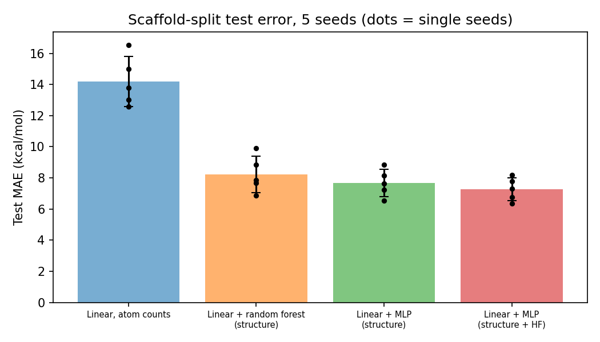
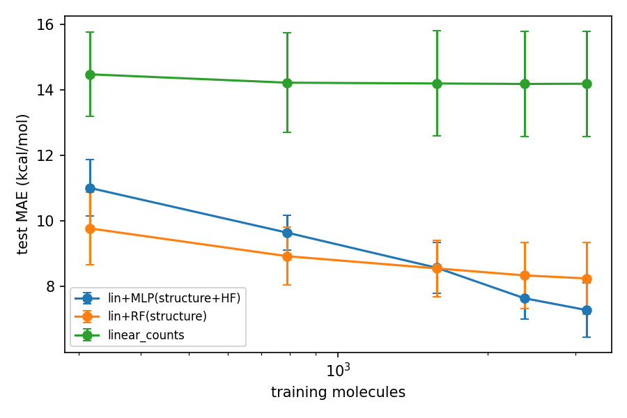

# Learning a fix for quantum chemistry energies (QM9)

A small study on Δ-learning: run a Hartree-Fock calculation, then train a model to guess what is still missing to reach a better DFT energy. People already know this idea, so I am not claiming anything new. I did it to get better at doing it with care, with baselines, a split that keeps whole ring systems out and a look at where the model fails and why.

## The question

Can a small neural network learn the gap between HF/STO-3G and the B3LYP energy stored in QM9? Does it beat baselines on molecules whose ring systems it has not seen? Do the outputs of the calculation (HOMO, LUMO, dipole) help beyond what the structure alone gives?

## What I did

- I picked 4,000 random QM9 molecules. RDKit could not read 52 of the SMILES (valence errors from the bond perception used to build them), so I dropped those. Worked with 3,948.
- I ran HF/STO-3G in PySCF on the QM9 geometries. All 4,000 converged, about 8 minutes on a laptop CPU.
- Target = (U0 − ZPVE) − E_HF in kcal/mol. QM9's U0 includes zero-point energy, so I subtract ZPVE to get an electronic energy. That is my reading of QM9. As a check, methane gives a gap of about −500 kcal/mol, which is the size I expected.
- Split by Murcko scaffold, 80/10/10, with 5 seeds. Whole scaffold groups go to one split. Molecules without rings have no scaffold, so they always go to train (430 of the 3,948 molecules).
- Models, all predicting the target:
  1. Training-set mean
  2. Linear model on atom counts (H, C, N, O, F)
  3. Linear + random forest on structure features
  4. Linear + small MLP on structure features
  5. Linear + small MLP on structure + HF features

The forest and the MLP fit the error the linear model leaves behind. Structure features are the atom counts plus a 1024-bit Morgan count fingerprint (radius 2). HF features are HOMO, LUMO, their gap and the dipole norm.

- The MLP has two hidden layers of 256 units, is trained on the standardised leftover error and stops early on the validation split. The test split is never used for training or stopping.

## Results

Error in kcal/mol, mean ± std over 5 seeds:

| Model | Test MAE | Test RMSE | Train MAE |
|---|---:|---:|---:|
| Training-set mean | 336.85 ± 21.90 | 433.56 ± 23.37 | 357.09 |
| Linear, atom counts | 14.18 ± 1.61 | 17.76 ± 1.54 | 14.72 |
| Linear + random forest (structure) | 8.23 ± 1.17 | 10.56 ± 1.03 | 2.41 |
| Linear + MLP (structure) | 7.68 ± 0.87 | 9.86 ± 0.83 | 0.91 |
| Linear + MLP (structure + HF) | 7.28 ± 0.74 | 9.32 ± 0.70 | 0.78 |



The seeds share their test difficulty, so the std is mostly split-to-split variation. The per-seed differences say more:

- MLP (structure) vs forest: lower by 0.55 on average, better in 5 of 5 seeds.
- Adding HF features to the MLP: lower by 0.40 on average, better in 5 of 5 seeds.
- Best MLP vs the linear baseline: lower by 6.9 on average, better in 5 of 5 seeds.

## What I found

**The linear model does most of the work.** Atom counts alone take the error from about 337 to 14 kcal/mol. The learned part roughly halves what is left.

**The models overfit. I could not fix it with simple regularisation.** The MLPs reach under 1 kcal/mol on training molecules but 7 to 8 on held-out scaffolds, and the forest goes from 2.4 to 8.2. The linear baseline has no such gap (14.7 train, 14.2 test). I tried dropout (0.2, 0.4), stronger weight decay, a 64-unit network and a 5-network ensemble, choosing by validation error. The best setting gave 7.17 test MAE against 7.28 for the original. The ensemble gave 7.18. The same dropout setting gave 7.17 in the regularisation script and 7.29 in the learning-curve script, which shows the network the same training molecules in a different order, so differences of about 0.1 come from arbitrary choices like that. The gap seems to come from the data (few molecules, unseen ring systems) and not from these settings. For scale, the MLP has about 330,000 weights and 1,033 input features against 3,160 training molecules, so it has plenty of room to memorise.

**More data would probably help the MLP, within the range I tested.** I trained on 10% to 100% of the training molecules (316 to 3,160) and tested on the same held-out scaffolds:

| Training molecules | Linear | Random forest | MLP (structure + HF) |
|---:|---:|---:|---:|
| 316 | 14.47 | 9.78 | 11.01 |
| 790 | 14.21 | 8.93 | 9.64 |
| 1580 | 14.19 | 8.56 | 8.57 |
| 2370 | 14.18 | 8.34 | 7.65 |
| 3160 | 14.18 | 8.25 | 7.29 |



Each doubling takes roughly 1 kcal/mol off the MLP's error and I see no plateau. The forest flattens earlier and is better than the MLP below about 1,500 molecules. I cannot say anything about sizes beyond 3,160. The comparison is not like-for-like, since the forest only sees structure features and the MLP also sees the HF features.

**The smallest molecules have the highest error, but mostly because the linear model leaves more behind there.** With 15 atoms or fewer, the best model has a test MAE of 8.3, against 5.9 for 22 or more atoms. The best model's error is about half the linear model's in every size group (ratio 0.50 to 0.56). The small-molecule groups also have a wider spread in what the linear model misses (std 19.8 against 12.5) and a higher fraction of non-carbon heavy atoms (0.41 against 0.14). Within the small-molecule groups, error is higher for the molecules with the most heteroatoms. In the 19–21 atom group the trend goes the other way, but that cell only has 65 test rows. So I read this as composition explaining part of the size effect, not all of it.

**Other breakdowns.** Error rises slowly with ring count, from 6.9 with one ring to 8.1 with four or more. Molecules with N or O are only slightly worse than those without. Only 18 test rows contain fluorine, and the MLP did worse than the forest there, which is too few rows to conclude anything. The worst molecules are off by 25 to 45 kcal/mol in both directions. Many have charged atoms in their SMILES. Those charges may be artifacts of how the SMILES were built from 3D geometries. I did not check.

## Limits

- Small sample: 4,000 molecules, one fixed sample. The 5 seeds change the split and the training, not the molecules.
- One pair of methods (HF/STO-3G and B3LYP), one dataset, one basis set.
- QM9 only has small molecules (up to nine heavy atoms), so none of this says how the approach works on drug-sized molecules.
- The test set only contains molecules with rings, since acyclic molecules always go to train. These numbers say nothing about acyclic molecules.
- A scaffold split holds out ring systems, but test molecules can still be chemically close to training ones.
- I measured errors in total energies. Errors in energy differences, for example between isomers, are often what matters in practice. I did not test them.
- Little tuning. I tried a small grid over regularisation. I did not tune learning rate, depth, fingerprint size or the forest settings, so the MLP vs forest comparison is not a careful one.
- No uncertainty estimates, no significance tests and no comparison with published results on similar tasks.
- The 52 unparseable molecules were dropped, which slightly biases the sample toward molecules RDKit can read.
- HF is run on the B3LYP geometries from QM9. In real use you would also need a geometry, and I did not count that cost.
- I did not compare with graph networks, Coulomb matrices or other representations.
- Even the best model is at about 7 kcal/mol. Chemical accuracy is about 1 kcal/mol, so this is not close.

## Run it

```bash
python3 -m venv .venv
source .venv/bin/activate
pip install -r requirements.txt --extra-index-url https://download.pytorch.org/whl/cu124

python scripts/01_prepare_data.py       # downloads QM9, samples 4000 molecules
python scripts/02_run_hf.py             # HF/STO-3G, about 8 min
python scripts/03_train_eval.py         # split, baselines, MLP, 5 seeds
python scripts/04_error_analysis.py     # by size, element, worst cases
python scripts/05_summary.py            # table and plot
python scripts/06_size_diagnostic.py    # why small molecules look worse
python scripts/07_regularise.py         # dropout / weight decay / ensemble
python scripts/08_learning_curve.py     # error vs training-set size
python scripts/09_check_split.py        # checks the scaffold splits
```

Tested in WSL2 (Ubuntu) with Python 3.10.12, torch 2.6.0, pyscf 2.15.1, rdkit 2026.9.2, scikit-learn 1.7.2 (all pins in `requirements.txt`, full list in `requirements-lock.txt`). PySCF is easier on Linux than on Windows. The MLP uses the GPU if PyTorch sees one, otherwise the CPU. It is small enough to train on a laptop.

## Reproducibility

- The versions are fixed in `requirements.txt` for the main packages and in `requirements-lock.txt` for the whole environment.
- You will find the 4,000-molecule sample and the HF/STO-3G outputs in `results/inputs/`, so you can check the target without rerunning HF. All 4,000 HF calculations did converge.
- The console output from a rerun is in `results/logs/`. That rerun used a fresh clone and a fresh virtual environment, on the same machine and GPU. The HF energies, orbital energies and dipoles came out the same as the first run, with a maximum difference of 0.0. `sample.csv` was the same too. The mean test MAE of every model matched the first run to three decimals. That check looked at means over seeds, not at individual seeds. The tables that scripts 04, 06, 07 and 08 print also match the first runs, compared by eye. Exact repeatability of GPU training may not hold on other hardware or driver versions.
- `scripts/09_check_split.py` makes sure no Murcko scaffold is shared between train, validation and test. It also checks that no molecule is lost or duplicated, that acyclic molecules stay in train and that the split comes out the same when repeated. All five seeds passed. The test sets hold 114 to 170 distinct scaffolds, depending on the seed.

## Layout

```text
src/        config, data loading, HF features, split, features, models, metrics
scripts/    the nine steps above
results/    metrics, predictions, error tables, summary.md, plots, inputs/, logs/
```